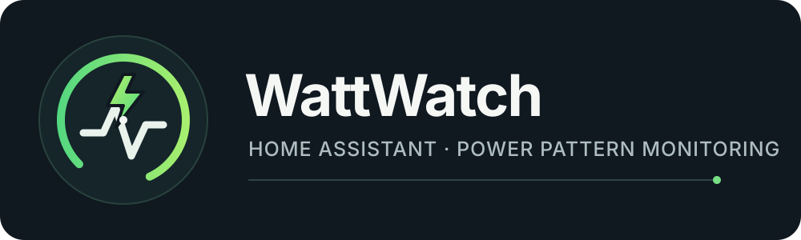
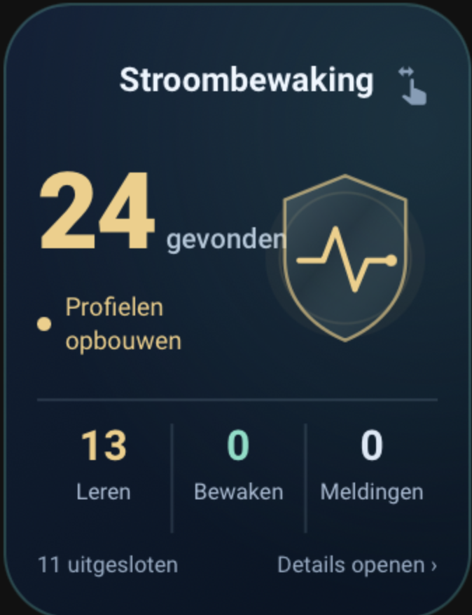

# WattWatch

<p align="center"></p>

**Local power monitoring for Home Assistant: learn normal appliance usage and notice sustained changes.**

English documentation below · [Nederlandse uitleg](#nederlandse-uitleg)

WattWatch discovers existing appliance power sensors, learns their usual hourly consumption patterns and notifies you when measured power stays unusually high or low. Setup takes one confirmation; no helpers, YAML, MQTT, Node-RED, subscription or cloud account are needed for the monitoring itself.

**Version 1.1.0 is a test release.** It needs real household testing and testing on current Home Assistant versions. A change in power consumption is a signal to investigate, not a diagnosis of a faulty appliance.

## What WattWatch does

- Discovers power sensors every minute and converts W, kW and mW to watts.
- Builds a separate local history for each selected power channel.
- Calculates time-weighted hourly averages instead of reacting to every short peak.
- Compares completed hours with earlier days around the same local time.
- Checks for sustained changes across 20, 30 and 60 minutes and two consecutive hours.
- Creates an overview sensor, an overall problem sensor and individual appliance status sensors.
- Shows these entities on the built-in WattWatch device page.
- Posts alerts in Home Assistant and can send push notifications to selected phones.
- Saves learning data locally and restores completed-hour history after a restart.

For example, a refrigerator that runs at unusually high power for several hours may trigger a notification after learning. A short kettle cycle is not the kind of change WattWatch is designed to detect. These are illustrative scenarios, not guaranteed detection outcomes.

## Requirements and languages

You need Home Assistant and existing **power sensors for individual appliances**. A smart plug with power measurement is one possible source. A plain on/off switch or an energy-only sensor in kWh is not enough.

The declared minimum Home Assistant version is 2024.12.0. The documented isolated tests used 2024.12.5; newer versions still require practical verification. **The bundled integration icon requires Home Assistant 2026.3 or newer.**

The interface includes **English and Dutch**. Users can install the public repository internationally; there is no country setting or country-specific electricity tariff requirement. Compatibility depends on the available power sensors and Home Assistant setup. More interface languages can be contributed through GitHub.

## Install through HACS

If WattWatch is not in your catalog, add it as a custom repository:

1. Open HACS and its **Custom repositories** menu.
2. Enter `https://github.com/Kprins1983/Wattwatch`.
3. Choose **Integration** as the category and add the repository.
4. Find WattWatch, download it and restart Home Assistant.
5. Open **Settings → Devices & services → Add integration**.
6. Search for **WattWatch**, open it and submit the start form.
7. Open the WattWatch integration and its device page to check the discovered sensors.

HACS menu names can vary by version. Downloading the files and adding the integration are separate steps.

## Manual installation

1. Download and extract the repository.
2. Copy the complete `custom_components/wattwatch` directory into your Home Assistant configuration directory's `custom_components` folder.
3. Keep all subfolders, including `brand` and `translations`.
4. Restart Home Assistant and add WattWatch through **Settings → Devices & services**.

The result should include:

```text
/config/custom_components/wattwatch/
├── __init__.py
├── manifest.json
├── brand/
│   └── icon.png
└── translations/
    ├── en.json
    └── nl.json
```

This is a partial directory listing; copy the complete integration, not just these files.

## Icon after installation

WattWatch includes its existing icon at `custom_components/wattwatch/brand/icon.png`. Home Assistant 2026.3+ supports this local branding automatically; users do not need to upload an icon themselves. See the [Home Assistant branding documentation](https://contributors.home-assistant.io/core/integrations/brands/).

After installing or updating, restart Home Assistant and refresh the browser or app. If necessary, download the integration again and check that the `brand` folder is present.

The icon shown in the **HACS catalog** depends on HACS's support for local brand images. Some versions have a [reported local-icon display issue](https://github.com/hacs/integration/issues/5171). A missing HACS catalog image alone does not mean installation failed. The integration logo, entity icons and GitHub account avatar are separate images.

## Learning and alerts

The first assessment needs all of the following:

- At least **7 days** since the first observation.
- At least **120 usable hours** in retained history.
- Reference measurements around the same local hour on at least **5 earlier days**.

An hour needs at least **45 minutes of valid coverage**. Unknown, unavailable, negative and non-finite readings do not count as zero. Long gaps interrupt continuity. Existing Home Assistant Recorder history is not imported, so learning starts when WattWatch starts collecting data.

Every ten minutes WattWatch checks continuous windows of approximately 20, 30 and 60 minutes against earlier windows of the same length around the same local hour. The average must exceed the historical range with a margin, and every ten-minute block must differ in the same direction from the usual level. Short windows require five earlier reference days in addition to the usual learning period. Existing installations retain hourly history and collect new short-window references after updating. The two-hour check continues alongside these checks.

Notifications appear inside Home Assistant. There is a 24-hour notification cooldown per channel. The same persistent notification is updated instead of stacked and is dismissed after a normally evaluated hour. Restarting preserves reference history but resets the two-hour confirmation.

For phone push, enable notifications in **Configure** and select the registered Companion App phones. Allow notifications on each phone. The integration does not currently account for outdoor temperature, weekdays versus weekends or appliance program selection.

## Automatic overview

No custom dashboard card is required. Open **Settings → Devices & services → WattWatch → WattWatch device**.

| Entity | Meaning |
| --- | --- |
| Overview / Gevolgde apparaten | Number of selected power channels, plus status counts in its attributes |
| Anomaly / Afwijkend verbruik | Overall problem sensor: on when any selected channel has a confirmed anomaly |
| Individual appliance sensor | Learning, normal, anomaly, unavailable or insufficient-data status |

Separate power channels of one physical appliance can appear separately. The overview counts channels, which is not always the number of physical appliances.

Individual status sensor attributes include `source_entity`, `learning_percent` and `learned_hours`. After a usable evaluation, additional attributes can include `average_watts`, `expected_watts`, `lower_watts`, `upper_watts` and `direction`. These evaluation values describe a completed hour, not live power.

## Dashboard card examples

<p align="center"></p>

*Custom dashboard design. The standalone example below uses this design with WattWatch’s own sensor attributes; the screenshot shows the original Dutch helper-based card. The card is not installed automatically.*

The styled card requires **custom:button-card**. The four simpler alternatives further below use built-in Home Assistant cards. All cards are optional.

**Replace every example entity ID with your own.** Entity IDs depend on the installation language, source sensor names and any renaming. Find them under **Developer tools → States** or on the WattWatch device page. For an appliance status entity, its `source_entity` attribute identifies the original power sensor.

On a dashboard, choose **Edit dashboard → Add card → Manual** and paste one example. Menu labels may vary.

### Styled WattWatch card — copy and paste

Install [Button Card](https://github.com/custom-cards/button-card) through HACS first and reload your browser. No swipe-card, card-mod, weather sensors or dashboard helpers are required.

Replace `variables.overview_entity` with the actual WattWatch overview entity ID. This is the sensor with the number of monitored channels and the `learning`, `normal`, `anomaly` and `excluded_sensors` attributes. Then paste the complete YAML into a Manual card. Tap the card to open the overview entity details.

The counters show learning channels, channels with normal status and confirmed anomalous channels. They do not count notifications. Channels with unavailable or insufficient data can make these counters add up to less than the total.

[Download the standalone YAML](examples/wattwatch-card.yaml).

<details>
<summary>Show the complete card YAML</summary>

```yaml
type: custom:button-card
show_name: false
show_icon: false
show_state: false
variables:
  overview_entity: sensor.wattwatch_gevolgde_apparaten
entity: '[[[ return variables.overview_entity; ]]]'
triggers_update:
  - '[[[ return variables.overview_entity; ]]]'
tap_action:
  action: more-info
hold_action:
  action: none
styles:
  card:
    - height: 220px
    - min-height: 220px
    - max-height: 220px
    - width: 100%
    - min-width: 0
    - box-sizing: border-box
    - padding: 0
    - border-radius: 24px
    - overflow: hidden
    - background: linear-gradient(145deg,#102239,#081525 85%)
    - border: 1px solid rgba(94,217,186,.25)
    - box-shadow: none
  grid:
    - grid-template-areas: '"content"'
    - grid-template-columns: minmax(0,1fr)
    - grid-template-rows: minmax(0,1fr)
    - height: 100%
    - min-width: 0
  custom_fields:
    content:
      - width: 100%
      - height: 100%
      - min-width: 0
      - white-space: normal
extra_styles: >
  :host{display:block!important;width:100%!important;max-width:100%!important;min-width:0!important;box-sizing:border-box;}

  #aspect-ratio,ha-card#card{width:100%!important;max-width:100%!important;min-width:0!important;box-sizing:border-box;}

  .watch{box-sizing:border-box;position:relative;isolation:isolate;overflow:hidden;width:100%;height:100%;padding:13px
  11px 12px;display:grid;grid-template-rows:27px minmax(0,1fr) 48px
  12px;gap:6px;text-align:left;color:#edf6ff;font-variant-numeric:tabular-nums;background:radial-gradient(ellipse
  at 90% 20%,rgba(70,190,174,.14),transparent 70%);}

  .watch *{box-sizing:border-box;}

  .head{display:flex;align-items:center;gap:6px;min-width:0;}

  .head>ha-icon{--mdc-icon-size:22px;color:#78dfc7;flex-shrink:0;}

  .title{font-size:12px;font-weight:700;min-width:0;}

  .head .swipe{margin-left:auto;--mdc-icon-size:15px;color:#819eb8;}

  .hero{display:flex;align-items:center;justify-content:space-between;gap:3px;min-height:0;min-width:0;}

  .reading{min-width:0;flex:1;}

  .number{font-size:38px;line-height:1.05;font-weight:750;letter-spacing:-1px;color:var(--watch-accent);}

  .number
  small{font-size:10px;letter-spacing:0;font-weight:500;color:#b1c8da;margin-left:4px;}

  .status{display:flex;align-items:center;gap:5px;color:var(--watch-accent);font-size:9px;line-height:1.35;margin-top:8px;}

  .dot{width:5px;height:5px;border-radius:50%;background:currentColor;flex-shrink:0;}

  .shield{display:block;width:66px;height:76px;flex:0 0
  66px;color:var(--watch-accent);}

  .metrics{display:grid;grid-template-columns:repeat(3,minmax(0,1fr));border-top:1px
  solid #8daec22e;padding-top:8px;min-width:0;}

  .metric{text-align:center;min-width:0;}

  .metric+.metric{border-left:1px solid #8daec22e;}

  .metric
  strong{display:block;font-size:15px;line-height:1.1;font-weight:700;color:var(--metric-accent);}

  .metric span{display:block;font-size:8px;color:#a7bdd5;margin-top:4px;}

  .foot{display:flex;justify-content:space-between;gap:4px;align-items:center;font-size:8px;line-height:12px;color:#96aec7;min-width:0;}

  .foot>span{white-space:nowrap;}

  @media(max-width:600px){.watch{padding:12px
  9px}.title{font-size:11px}.number{font-size:34px}.shield{width:58px;height:69px;flex-basis:58px}.number
  small{font-size:9px}.head>ha-icon{--mdc-icon-size:20px}}
custom_fields:
  content: |
    [[[
      const overview = states[variables.overview_entity];
      const known = overview && !['unknown', 'unavailable'].includes(overview.state);
      const attrs = overview?.attributes || {};
      const count = key => known && Number.isFinite(Number(attrs[key])) ? Number(attrs[key]) : null;
      const found = known && Number.isFinite(Number(overview.state)) ? Number(overview.state) : null;
      const learning = count('learning');
      const active = count('normal');
      const alerts = count('anomaly');
      const excluded = known && attrs.excluded_sensors && typeof attrs.excluded_sensors === 'object'
        ? Object.keys(attrs.excluded_sensors).length : null;
      const display=n=>n===null?'—':n;
      const accent=alerts>0?'#ffae93':learning>0?'#f2ce83':'#78dfc7';
      const label=!known?'Waiting for data':alerts>0?'Unusual power detected':learning>0?'Learning patterns':active>0?'Monitoring patterns':excluded>0?'No monitored channels':'No monitored channels';
      return `<div class="watch" style="--watch-accent:${accent}">
        <div class="head"><ha-icon icon="mdi:shield-pulse-outline"></ha-icon><span class="title">WattWatch</span></div>
        <div class="hero"><div class="reading"><div class="number">${display(found)}<small>monitored</small></div><div class="status"><span class="dot"></span>${label}</div></div>
          <svg class="shield" viewBox="0 0 76 88" aria-hidden="true"><defs><linearGradient id="sw-glass" x1="0" y1="0" x2=".9" y2="1"><stop stop-color="#c2efe8" stop-opacity=".2"/><stop offset=".45" stop-color="#82bfc8" stop-opacity=".035"/><stop offset="1" stop-color="#092333" stop-opacity=".4"/></linearGradient></defs><circle cx="38" cy="44" r="33" fill="currentColor" opacity=".045"/><circle cx="38" cy="44" r="27" fill="none" stroke="currentColor" stroke-opacity=".12"/><path d="M38 10 63 20v24c0 17-11 28-25 34C24 72 13 61 13 44V20Z" fill="url(#sw-glass)" stroke="currentColor" stroke-width="1.4" stroke-opacity=".65"/><path d="M19 45h10l5-13 8 25 5-12h10" fill="none" stroke="currentColor" stroke-width="2.3" stroke-linecap="round" stroke-linejoin="round"/><circle cx="57" cy="45" r="2.4" fill="currentColor"/></svg>
        </div>
        <div class="metrics"><div class="metric" style="--metric-accent:#f2ce83"><strong>${display(learning)}</strong><span>Learning</span></div><div class="metric" style="--metric-accent:#78dfc7"><strong>${display(active)}</strong><span>Normal</span></div><div class="metric" style="--metric-accent:${alerts>0?'#ffae93':'#dce8f6'}"><strong>${display(alerts)}</strong><span>Anomalies</span></div></div>
        <div class="foot"><span>${display(excluded)} excluded</span><span>Open details ›</span></div>
      </div>`;
    ]]]
```

</details>

### 1. Compact overview

Shows the number of monitored channels and whether a confirmed anomaly exists.

```yaml
type: entities
title: WattWatch
show_header_toggle: false
entities:
  - entity: sensor.wattwatch_gevolgde_apparaten
    name: Monitored channels
  - entity: binary_sensor.wattwatch_afwijkend_verbruik
    name: Unusual power use
```

### 2. Appliance status and learning progress

Use the individual WattWatch status entity, not the original power sensor, for this card. The example ID is a placeholder.

```yaml
type: entities
title: Refrigerator monitoring
show_header_toggle: false
entities:
  - entity: sensor.wattwatch_refrigerator
    name: Status
  - type: attribute
    entity: sensor.wattwatch_refrigerator
    attribute: learning_percent
    name: Learning progress
    suffix: "%"
  - type: attribute
    entity: sensor.wattwatch_refrigerator
    attribute: learned_hours
    name: Retained learning hours
```

Progress reaching 100% does not by itself guarantee sufficient same-hour references for every assessment.

### 3. Power history

Use the **original appliance power sensors** for a power graph. WattWatch's individual sensors contain text statuses, not a live watt reading.

```yaml
type: history-graph
title: Appliance power — last 24 hours
hours_to_show: 24
entities:
  - entity: sensor.refrigerator_power
    name: Refrigerator
  - entity: sensor.freezer_power
    name: Freezer
```

Home Assistant Recorder must retain those sensors for the history graph to have data. This chart uses Recorder history; the WattWatch detector uses its own locally collected hourly history.

### 4. Warning shown only during an anomaly

Replace the binary sensor ID in the condition.

```yaml
type: conditional
conditions:
  - entity: binary_sensor.wattwatch_afwijkend_verbruik
    state: "on"
card:
  type: markdown
  title: WattWatch warning
  content: |
    Unusual power consumption has been detected.
    Open the WattWatch device page to see which appliance is affected.
    Check the appliance and its measurements before drawing conclusions.
```

## Sensor selection and settings

Open **Settings → Devices & services → WattWatch → Configure → Sensitivity** and choose an option from the dropdown. One setting applies to all monitored appliances.

| Setting | When WattWatch alerts |
| --- | --- |
| **Normal** (default) | Uses the standard margin around each appliance’s learned power range. |
| **Wide** | Allows a larger deviation before alerting. Useful if ordinary usage changes often trigger alerts. |
| **Sensitive** | Uses a smaller margin so that smaller sustained changes can trigger an alert. |

The selected margin applies to the 20-, 30- and 60-minute checks and the two-hour check. All three settings use the same learning period and assessment windows.

WattWatch uses naming clues to skip likely whole-home meters, solar generation, batteries and totals. Automatic selection is imperfect: Home Assistant does not provide a universal appliance-versus-total classification.

Under the integration's **Configure** options you can:

- Disable Home Assistant notifications.
- Exclude sensors.
- Explicitly include suitable power sensors that were automatically skipped.

Exclusion takes priority. Including a kWh sensor does not turn it into a power sensor. Clear same-name aliases on the same registered device can be deduplicated; unrelated duplicates may still need manual exclusion.

## Privacy, storage and removal

WattWatch itself makes no cloud requests. Your existing smart plug or meter integrations may have their own network behavior.

Up to 21 days of short-window and hourly averages are retained locally. Data is saved approximately every five minutes and on a normal reload. A power failure may lose the most recent unsaved data. The unfinished current hour is rebuilt after restarting.

Removing the integration through Home Assistant removes WattWatch's stored learning data. Recorder history follows Home Assistant's normal retention settings. To deliberately learn a completely new baseline, remove and re-add the integration.

## Troubleshooting

| Symptom | What to check |
| --- | --- |
| No appliances found | Source entities must report power in W, kW or mW; review automatic exclusions and Configure options |
| Still learning after a week | Check usable-hour count, sensor gaps and sufficient earlier-day references |
| Missing integration icon | Use Home Assistant 2026.3+, keep the brand folder, restart and refresh |
| Missing HACS catalog icon | Check your HACS version and its local-brand support |
| Dashboard says entity not found | Replace example entity IDs with the actual IDs from your installation |
| No power chart | Use original numeric power sensors and check Recorder history |
| Push notification did not arrive on the selected phone | Enable alerts, select a registered Companion App phone in Configure and check its notification permission |

## International availability and contributions

The public repository can be installed through HACS as a custom repository or manually. This is separate from acceptance into the default HACS catalog.

Default catalog inclusion requires the publisher's submission and review. HACS documents successful HACS/Hassfest checks and a GitHub release among its submission requirements. See the [official publishing guide](https://github.com/hacs/documentation/blob/main/source/docs/publish/include.md).

Please report bugs in [GitHub Issues](https://github.com/Kprins1983/Wattwatch/issues), preferably in English so others can join the discussion. Include Home Assistant and HACS versions, WattWatch version, reproduction steps and relevant logs with private details removed.

Translation contributions are welcome in `custom_components/wattwatch/translations/`. Keep translation keys consistent with `strings.json`; do not translate internal state values or entity attribute keys.

## Development and test status

The documented isolated tests passed with Python 3.12.14 and Home Assistant 2024.12.5. See [TESTRESULTATEN.md](TESTRESULTATEN.md) for their scope. These historical results do not establish compatibility with every newer Home Assistant version or detection accuracy in every household.

```sh
python -m pip install -r requirements-test.txt
python -m pytest -q
```

Licensed under the [MIT License](LICENSE).

## Nederlandse uitleg

**WattWatch leert het normale stroomverbruik van apparaten in Home Assistant en signaleert langdurige veranderingen.** De integratie gebruikt bestaande vermogenssensoren van bijvoorbeeld slimme stekkers. Er is geen abonnement of cloudaccount nodig voor WattWatch.

### Installeren

1. Open HACS en voeg via **Aangepaste repositories** deze URL toe: `https://github.com/Kprins1983/Wattwatch`.
2. Kies als type **Integratie**, download WattWatch en herstart Home Assistant.
3. Ga naar **Instellingen → Apparaten & diensten → Integratie toevoegen → WattWatch**.
4. Klik op **Verzenden** en open daarna het apparaat WattWatch voor het overzicht.

De schermteksten zijn beschikbaar in het Nederlands en Engels. Het bestaande icoon wordt meegeleverd; Home Assistant **2026.3 of nieuwer** ondersteunt dit lokale integratie-icoon. De icoonweergave in HACS hangt ook af van de gebruikte HACS-versie.

### Wat gebeurt er na installatie?

WattWatch zoekt iedere minuut geschikte vermogenssensoren en leert per kanaal het gebruikelijke patroon. De eerste beoordeling vraagt minimaal zeven dagen, 120 bruikbare meeturen en voldoende vergelijkingen op eerdere dagen rond hetzelfde tijdstip. Ontbrekende meetgegevens kunnen dit verlengen. Bestaande Recorder-geschiedenis wordt niet ingelezen.

WattWatch beoordeelt elke tien minuten periodes van ongeveer 20, 30 en 60 minuten. Het vergelijkt deze met even lange periodes rond hetzelfde tijdstip op eerdere dagen. Een vroege melding vraagt een afwijkend gemiddelde én een aanhoudende verandering in dezelfde richting. Na de update blijven bestaande uurprofielen bruikbaar. De korte controles verzamelen eerst referenties op minstens vijf eerdere dagen en vereisen ook een voltooid basisprofiel. De controle over twee opeenvolgende uren blijft actief. Selecteer je telefoon bij **Configureren** voor pushmeldingen.

### Overzicht en kaarten

Op de apparaatpagina staan **Gevolgde apparaten**, **Afwijkend verbruik** en de statussen per apparaat. Er wordt geen apart dashboard geïnstalleerd.

De vormgegeven kaart hierboven gebruikt **Button Card** uit HACS. Pas `variables.overview_entity` aan naar je eigen WattWatch-overzichtssensor. Swipe Card, Card Mod en helpers zijn voor dit voorbeeld niet nodig. De vier eenvoudigere YAML-voorbeelden tonen een compact overzicht, leerstatus, vermogensgrafiek en een waarschuwing die alleen bij een afwijking verschijnt. Gebruik **Dashboard bewerken → Kaart toevoegen → Handmatig**. Vervang alle voorbeeld-entiteitsnamen door je eigen namen. Gebruik voor grafieken de oorspronkelijke vermogenssensoren; WattWatch-statussensoren bevatten tekst.

### Gevoeligheid instellen

Open **Instellingen → Apparaten & diensten → WattWatch → Configureren → Gevoeligheid**. Kies in het keuzemenu één stand voor alle bewaakte apparaten.

| Stand | Wanneer krijg je een melding? |
| --- | --- |
| **Normaal** (standaard) | WattWatch gebruikt de standaardmarge rond het aangeleerde verbruiksbereik van elk apparaat. |
| **Ruim** | Het verbruik mag verder afwijken. Handig wanneer gewone veranderingen in gebruik vaak een melding geven. |
| **Gevoelig** | De marge is kleiner. Ook een kleinere verandering kan een melding geven als die aanhoudt. |

De gekozen marge geldt voor de controles van 20, 30 en 60 minuten en voor de twee-uurscontrole. De leertijd en meetperiodes zijn bij alle drie de standen gelijk.

### Instellingen en beperkingen

Via **Configureren** kun je meldingen uitzetten en sensoren uitsluiten of alsnog opnemen. Controleer of de selectie klopt: totaalsensoren en dubbele meetbronnen zijn niet altijd automatisch herkenbaar. WattWatch houdt nog geen rekening met buitentemperatuur, werkdag/weekend of apparaatprogramma's.

Leerdata blijft lokaal en wordt maximaal 21 dagen bewaard. Na een herstart blijft de referentiegeschiedenis behouden; de bevestiging van twee afwijkende uren begint opnieuw. Verwijderen en opnieuw toevoegen laat WattWatch opnieuw leren.

Dit is een testversie. Lees ook [LEESMIJ_EERST.md](LEESMIJ_EERST.md) en [TESTRESULTATEN.md](TESTRESULTATEN.md). De repository is wereldwijd te installeren; opname in de standaard HACS-catalogus vraagt een aparte aanvraag en beoordeling.
